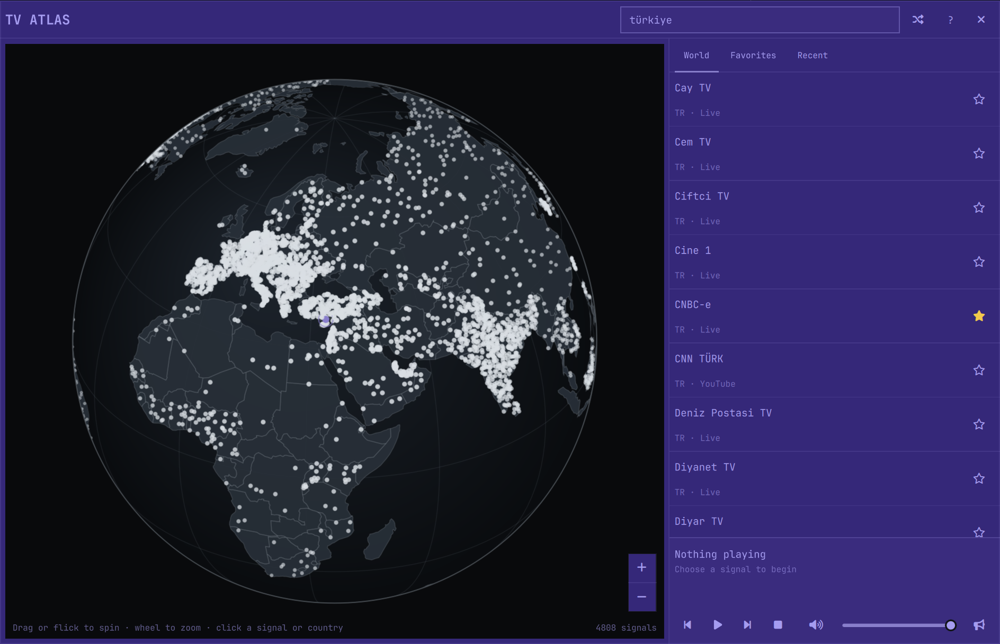

# TV Atlas

Explore live TV from around the world on a rotatable globe, right from the
Omarchy bar. Channels come from [Famelack](https://famelack.com)'s curated,
continuously validated public dataset.



## Features

- About 6,900 live channels in 174 countries, placed on a rotatable, zoomable,
  theme-aware globe
- Click a country to browse its channels, or click a signal to start watching
- Search by channel name, country, language, or category (news, sports, kids,
  movies, music, weather, ...)
- Channels play in a small picture-in-picture `mpv` window in the bottom-right
  corner, pinned across workspaces; press `Super+O` on it to tile it like a
  normal window. Controlled from the panel and Omarchy's media controls
- Direct HLS streams, plus YouTube live channels through `yt-dlp`
- Geo-blocked channels are labelled
- Favorites, watch history, random tuning, volume, and an audio output picker
- Keyboard navigation (press `?` in the panel)

## Install

```bash
omarchy plugin add https://github.com/dincercelik/omarchy-tv-atlas.git --enable
```

Requires `bubblewrap`, `curl`, `iproute2`, `jq`, `mpv`, `python`,
`python-dbus`, `python-gobject`, `socat`, `coreutils`, and `util-linux`, which
ship with Omarchy. YouTube channels also need `yt-dlp`
(`omarchy pkg add yt-dlp` if it is missing).

## Remove

Stop the player before removing the plugin:

```bash
~/.config/omarchy/plugins/dincercelik.tv-atlas/tv-player stop
omarchy plugin remove dincercelik.tv-atlas
```

Favorites, history, volume, and the selected audio output stay in
`~/.local/share/tv-atlas/state.json`; delete that directory and
`~/.cache/omarchy-tv-atlas` to remove everything.

## How it works

`tv-fetch` downloads `https://data.famelack.com/tv/categories/all.json`
once, normalizes it into `~/.cache/omarchy-tv-atlas/catalog.json`, and
refreshes it in the background once it is a day old. Country views read
`tv/countries/<cc>.json`, and category searches read
`tv/categories/<category>.json`. Search, random tuning, and favorite refreshes
run locally against the cached catalog.

Direct streams are preferred; channels that only have a YouTube source are
played through mpv's yt-dlp hook (capped at 1080p). Famelack does not publish
coordinates or logos, so channels are placed at country-level positions.

`mpv` runs in a network-isolated `bubblewrap` sandbox. Its only way out is
`tv-proxy`, which allows public destinations only. The video window uses the
app id `tv-atlas`. When the panel opens, the plugin registers a Hyprland rule
that opens it floating and pinned at 600×338 in the bottom-right corner, tagged
`pop` like Omarchy's `Super+O` pop-out, so `Super+O` tiles it and pops it out
again. To change that, add your own rule for class `tv-atlas` in
`~/.config/hypr/`. Closing the window stops playback.

## Tests

```bash
tests/run                        # full suite
python3 tests/headless.test.py   # same, inside an isolated D-Bus session
```

The QML tests use Omarchy's shell modules, so run them on an Omarchy system.

## Credits

- Fork of [Radio Atlas](https://github.com/AksharP5/omarchy-radio-atlas) by
  Akshar Patel (MIT), adapted from radio to TV.
- Channel data: [Famelack](https://famelack.com)
  ([famelack-data](https://github.com/famelack/famelack-data), MIT). The
  license does not cover the third-party streams it points to.
- Map data: Natural Earth (public domain). See `assets/NOTICE.md`.

Not affiliated with Famelack.

## License

MIT. See `LICENSE`.
